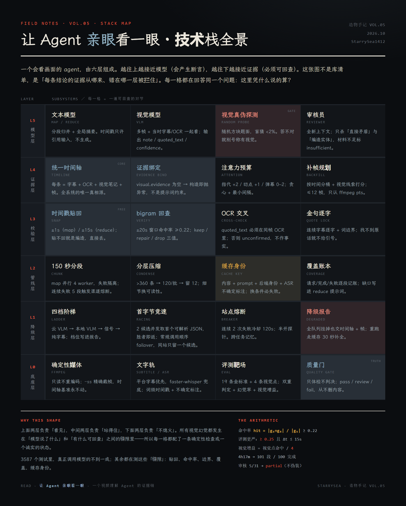

# 让 Agent 亲眼看一眼 · 造物手记 VOL.05

> 一个视频理解 Agent 的证据链：从「疑点」到「证据」再到「结论」，一条不许跳步的链。

**[打开这一页 →](https://starrysea1412.github.io/seeflow-story/)**



SeeFlow（[源码仓库](https://github.com/StarrySea1412/seeflow)）的解剖报告。市面上的视频总结工具都在做同一件事：把字幕丢给模型。可字幕是视频里分辨率最低的一层。这篇拆一个真的会看画面的 agent：它在哪里看、看完怎么记账、说错话时又是哪一行代码把它抓住。

## 七章

| # | 章节 | 讲什么 |
|---|---|---|
| 01 | 字幕之外 | 视频的四条信号轨；19 条金标准里的 4 条视觉点；一次诚实的缺席（OCR 未安装） |
| 02 | 看哪里 | 注意力预算：指代 +2 / 切点 +1 / 弹幕 0–2；1110 帧 → 4 次调用；三帧一组带上下文看 |
| 03 | 证据先于结论 | `Timeline.add` 拒绝无证据的视觉笔记；一帧只用一次；补帧只补时间分布 |
| 04 | 用代码杀死幻觉 | 五层校验：时间戳贴回、±20s bigram 回查（keep/repair/drop）、OCR 交叉、金句逐字、独立审核环；**一条真实要点走完五层** |
| 05 | 打不过就降级 | 四档阶梯；随机方块测视觉（盲猜 <2%）；首字节竞速、站点熔断、内容失败不重试 |
| 06 | 四小时是另一道题 | 101 段 / 94 缓存 / 1 失败；分层压缩；覆盖账本；审核 5/31；3.45% 支持率的正确读法 |
| 07 | 怎么证明它真的在看 | 金标准双重判定、视觉增益单独定价、夹具基线能测什么、受控重跑与完整性哈希、3587 个测试 |

## 四枚可玩小样

全部是**确定性模型**（不是录屏），参数与公式写在正文里：

- **注意力预算台**：拖 max_points / min_gap，开关三个信号，看 agent 把「看」分配给谁；四条视觉金标大多不会被任何参数选中——这就是启发式注意力的边界。
- **断言回查器**：keep / repair / drop 三值判决随阈值翻转；「编造数字」预设会当场暴露 bigram 的盲区；另附评测模式（时间窗 + 内容相似度双重判定）。
- **降级阶梯**：四档能力清单 + OCR 是否安装 + 探测超时 90s/15s，看「慢端点 15 秒超时被静默降级」怎么发生。
- **覆盖账本**：4h17m 的 101 格现实；分段长度、失败率、缓存命中率、诚实披露开关，看报告会多出哪些警告。

## 技术实现

- `index.html` 单文件承载：零构建、零依赖、原生 JS；示意图为手写 SVG / DOM
- 暗色放映室主题（`--bg #0b0d10` / 钢蓝 `#8fb0c2` / 珊瑚红 `#e0533c`）
- 自托管 LXGW 文楷子集（1115 字形 × 2 字重，各约 240KB）
- 五张插图由 GPT 系图像模型生成
- 验收：本地静态服务 + Playwright 无头逐状态截图（`build/verify.mjs`、`build/scroll.mjs`），0 pageerror、0 broken image、移动端 0 横向溢出

## 构建

```bash
node build/build.mjs        # build/*.html + style.css + demos.js → index.html
node build/verify.mjs       # 四枚小样逐状态截图 + 错误收集 → shots/
node build/scroll.mjs       # 逐屏截图（发现真实空白）→ shots/scroll/
node build/render-stack.mjs # docs/tech-stack.html → assets/tech-stack.png
```

`build/chars.txt` 是全文用字表，字体子集按它生成（`fontTools.subset`）。

## 数字出处

正文里的任务编号都可在 SeeFlow 仓库的 `work/` 目录下核对：

- `f1b818c4` — 影视飓风 2025 相机颁奖，618 条时间轴，12 张证据帧，207.16s 全流程
- `010f4e2c2eb5` — 4h17m 访谈，2758 条记录，101 段 / 100 完成 / 94 缓存，29 条要点，5/31 完成审核
- `e1518f997fb5` — 587s 评测视频，4 段中 3 段内容失败，重新生成 + 补 12 帧用 120.75s

评测结果与夹具基线在 `eval/results/` 下。
